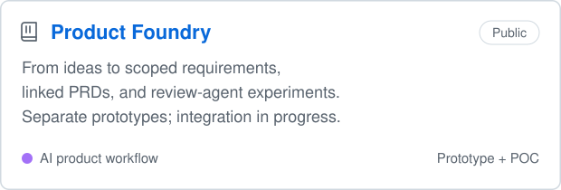
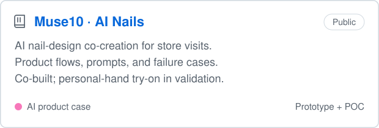
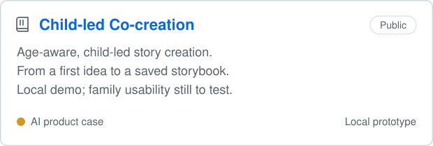
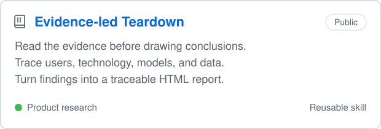
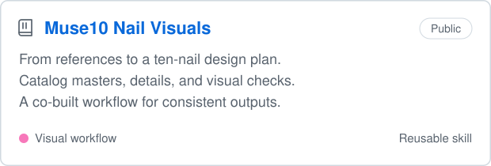
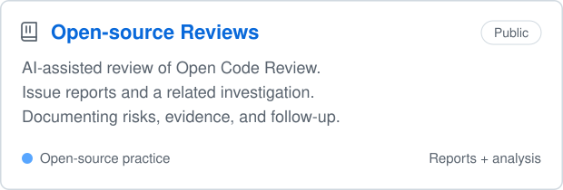

# Hi, I'm Eve 👋

<a href="https://wangyangjuan.surge.sh/">
<picture>
  <source media="(prefers-color-scheme: dark)" srcset="assets/portfolio-launch-dark.svg">
  <source media="(prefers-color-scheme: light)" srcset="assets/portfolio-launch-light.svg">
  
</picture>
</a>

Click the terminal to explore my personal website · wangyangjuan.surge.sh

I explore how AI can move from impressive demos to useful, trustworthy products.  
My work spans product discovery, workflow design, prompt iteration, and task-based evaluation.  
I use AI coding tools to build and test prototypes—and document what works, what fails, and what still needs evidence.

🌐 [Personal website](https://wangyangjuan.surge.sh/) · ✍️ [WeChat](https://mp.weixin.qq.com/mp/profile_ext?action=home&__biz=MzcwNzQzMDkxMw==&scene=124#wechat_redirect) · [Xiaohongshu](https://www.xiaohongshu.com/user/profile/634fb9e1000000001802b00f) · ✉️ [Email](mailto:wangyangjuanwyj@gmail.com)

## ⭐ Selected work

Product cases, practical tools, and reusable methods. Cards link to the work and its current stage.

<!-- fanxiaoyi-cover:start -->

<!-- fanxiaoyi-cover:end -->

<a href="https://github.com/EveEveeee/product-foundry">
<picture>
  <source media="(prefers-color-scheme: dark)" srcset="assets/projects/product-foundry-dark.svg">
  <source media="(prefers-color-scheme: light)" srcset="assets/projects/product-foundry-light.svg">
  
</picture>
</a>

<a href="https://github.com/EveEveeee/muse10-ai-nails">
<picture>
  <source media="(prefers-color-scheme: dark)" srcset="assets/projects/muse10-ai-nails-dark.svg">
  <source media="(prefers-color-scheme: light)" srcset="assets/projects/muse10-ai-nails-light.svg">
  
</picture>
</a>

<a href="https://github.com/EveEveeee/child-knowledge-cocreation">
<picture>
  <source media="(prefers-color-scheme: dark)" srcset="assets/projects/child-knowledge-cocreation-dark.svg">
  <source media="(prefers-color-scheme: light)" srcset="assets/projects/child-knowledge-cocreation-light.svg">
  
</picture>
</a>

<a href="https://github.com/EveEveeee/Eve/tree/main/skills/evidence-led-product-teardown">
<picture>
  <source media="(prefers-color-scheme: dark)" srcset="assets/projects/evidence-led-teardown-dark.svg">
  <source media="(prefers-color-scheme: light)" srcset="assets/projects/evidence-led-teardown-light.svg">
  
</picture>
</a>

<a href="https://github.com/EveEveeee/Eve/tree/main/skills/muse10-nail-visuals">
<picture>
  <source media="(prefers-color-scheme: dark)" srcset="assets/projects/muse10-nail-visuals-dark.svg">
  <source media="(prefers-color-scheme: light)" srcset="assets/projects/muse10-nail-visuals-light.svg">
  
</picture>
</a>

<a href="CONTRIBUTIONS.md">
<picture>
  <source media="(prefers-color-scheme: dark)" srcset="assets/projects/open-source-reviews-dark.svg">
  <source media="(prefers-color-scheme: light)" srcset="assets/projects/open-source-reviews-light.svg">
  
</picture>
</a>

[Explore all projects →](PROJECTS.md) · [Open-source contributions →](CONTRIBUTIONS.md)

## 🔎 Currently exploring

- **Requirements to decisions:** keeping scope, PRDs, and review evidence aligned as an idea changes.
- **Visual AI for real visits:** consistent ten-nail designs, useful store workflows, and the limits of personal-hand try-on.
- **Child-led creation:** age-aware story flows that preserve a child's choices and make model output easier to assess.

These are ongoing experiments, not claims of production readiness or proven user impact.

## 📝 Evidence-led Product Teardown

A reusable research skill for product analysis grounded in screenshots, accessible pages, code, and operation records. It traces the user, technology, model, and data layers into an HTML report. When evidence is missing, it identifies the gaps instead of inventing an architecture.

[Explore the skill →](https://github.com/EveEveeee/Eve/tree/main/skills/evidence-led-product-teardown) · [See the workflow →](https://wangyangjuan.surge.sh/tools/product-teardown.html)

## ✍️ Writing

I write about AI products, agents, human–AI collaboration, and evaluation on **Manman Says AI**, my WeChat publication. Below are the six most recent posts; English titles link to the original Chinese articles.

- [Muse, Grok Bot, Dots, and Cue: Why Build a Team of Assistants?](https://mp.weixin.qq.com/s?__biz=MzcwNzQzMDkxMw==&mid=2247483748&idx=1&sn=b60dce549cb151f75da81ce3c258bb41&chksm=f4c45e0ac3b3d71cc3d911521cf014874de6f9cebe378647d92a00213f31d194f4c61fd744e3#rd) · 2026-10-07
- [WorkBuddy: Saving Time on Writing Reports—or Finding the Evidence?](https://mp.weixin.qq.com/s?__biz=MzcwNzQzMDkxMw==&mid=2247483733&idx=1&sn=c239764ce74122a1c01186dc7ca17450&chksm=f4c45e3bc3b3d72d6a1c0fe15015960638bb1740cd96252248d0a7877a88112bfe12ba2cade6#rd) · 2026-09-22
- [JEV and Model Integration: How Much Work Can One Label Save?](https://mp.weixin.qq.com/s?__biz=MzcwNzQzMDkxMw==&mid=2247483726&idx=1&sn=e6055fab3279a033aff27d1d7ffa1b6d&chksm=f4c45e20c3b3d736f6a3f0729505640079d9da96749021433ea26c050c070df3bba79fe072c6#rd) · 2026-09-21
- [Grok Bot Works as a Team. Does That Mean Less Work for Us?](https://mp.weixin.qq.com/s?__biz=MzcwNzQzMDkxMw==&mid=2247483719&idx=1&sn=1553419bfbb7ab2edc8ff860c4a82c56&chksm=f4c45e29c3b3d73f92b2b64d81447c884e82d8d18dd1e7b7ed40782b187eaa6f0c84963d1b9c#rd) · 2026-09-20
- [When AI Handles the Final Step, What Should Stay with People?](https://mp.weixin.qq.com/s?__biz=MzcwNzQzMDkxMw==&mid=2247483711&idx=1&sn=10bfdf3a86c014991c84d7c887d28e7c&chksm=f4c45e51c3b3d74736cfa6a7537e9407e296ef60c2f06a2f973e6348719b6e88e8ade5953ea5#rd) · 2026-09-14
- [When AI Judges AI, Evaluation May Be the First Thing to Drift.](https://mp.weixin.qq.com/s?__biz=MzcwNzQzMDkxMw==&mid=2247483704&idx=1&sn=aab6a01d4507ec5c9169cbe95c1a7778&chksm=f4c45e56c3b3d7400088540ef2f3ae82977c4bbc2441388e7629a12fa0bc59c0dac97edb094e#rd) · 2026-09-08

[Read all 12 articles →](ARTICLES.md) · [Personal website →](https://wangyangjuan.surge.sh/)

## About me

**AI Product Manager**

- Product discovery and first-release scope
- AI workflows, interaction design, and human handoffs
- Prompt design, task-based evaluation, and failure analysis
- AI-assisted prototyping and open-source practice
- Writing to clarify product decisions

**Define** the task and boundaries · **Design** the flow · **Evaluate** the outcome · **Iterate** from evidence

Think clearly. Build thoughtfully. Keep learning.
