# 你好，我是 Eve 👋

<a href="https://wangyangjuan.surge.sh/">
<picture>
  <source media="(prefers-color-scheme: dark)" srcset="assets/portfolio-launch-dark.svg">
  <source media="(prefers-color-scheme: light)" srcset="assets/portfolio-launch-light.svg">
  
</picture>
</a>

点击终端，进入我的个人网站 · wangyangjuan.surge.sh

我关注 AI 如何从令人惊艳的演示，走向有用、可靠的产品。  
我的工作涵盖产品探索、工作流设计、提示词迭代和任务评测。  
我用 AI 编程工具搭建和测试原型，记录哪些有效、哪些失败，以及哪些判断仍需要证据。

🌐 [个人网站](https://wangyangjuan.surge.sh/) · ✍️ [公众号](https://mp.weixin.qq.com/mp/profile_ext?action=home&__biz=MzcwNzQzMDkxMw==&scene=124#wechat_redirect) · [小红书](https://www.xiaohongshu.com/user/profile/634fb9e1000000001802b00f) · ✉️ [邮箱](mailto:wangyangjuanwyj@gmail.com)

## ⭐ 精选项目

产品看功能与体验，技能看可复用流程，文档看报告与分析。封面上的分类标识对应不同的作品类型。

<!-- fanxiaoyi-cover:start -->

<!-- fanxiaoyi-cover:end -->

[查看全部项目 →](PROJECTS.md) · [查看开源贡献 →](CONTRIBUTIONS.md)

<!-- ai-news:start -->
## 📰 每日 AI 资讯

整理日期：**2026-10-27** · 关注 AI 产品、模型与工具动态。

- **OpenAI 新增 Signals 工作活动数据，呈现 ChatGPT 的工作用途**（事件日期：2026-10-26）
  新增数据覆盖近 100 个国家、165 类工作活动，按季度呈现 2025 年一季度至 2026 年三季度的 ChatGPT 工作用途。统计经聚合和隐私保护处理，仅包含个人计划中的工作相关消息，不含企业消息或 Codex，不能直接推断就业替代或生产率因果关系。 [查看OpenAI 官方文章原文](https://openai.com/index/chatgpt-expanding-world-of-work/)

- **Hugging Face 汇总开发工具更新，强化共享缓存与任务自动化**（事件日期：2026-10-26）
  HF 介绍近期 CLI 与 huggingface_hub 更新，支持跨仓复用相同 Xet 文件、任务失败重试及 webhook 触发 Jobs，并提供实验性 CPU/GPU 云沙箱，方便智能体隔离运行代码。这是近期功能的集中介绍，云沙箱仍处于实验阶段。 [查看Hugging Face 官方博客原文](https://huggingface.co/blog/huggingface/whats-new-in-the-hf-cli-and-huggingface-hub-librar)

- **Google 正式推出 LookML 语义索引，为智能体提供统一业务指标**（事件日期：2026-10-26）
  Looker Core 的 LookML 业务逻辑现可自动同步至 Knowledge Catalog，让 Gemini Enterprise 和自建智能体查询指标定义、表连接规则及数据血缘。功能适用于 Google Cloud 上的 Looker Core，需启用相关索引和 API，数据访问仍受最终用户 IAM 权限约束。 [查看Google Cloud 官方博客原文](https://cloud.google.com/blog/products/business-intelligence/lookml-metadata-indexing-in-knowledge-catalog-is-now-ga/)

[查看资讯归档 →](AI_NEWS.md) · [个人网站资讯栏目 →](https://wangyangjuan.surge.sh/#news)
<!-- ai-news:end -->

## 🔎 正在探索

- **从需求到决策：**在想法变化时，让项目范围、PRD 和审阅证据保持一致。
- **面向真实到店场景的视觉 AI：**关注十指设计的一致性、美甲店的实用流程，以及个人手部试戴的能力边界。
- **由孩子主导的创作：**根据年龄设计故事流程，保留孩子的选择，让模型输出更容易评估。

项目仍在实验阶段，生产可用性与用户成效尚待验证。

## 📝 循证产品拆解

一个可复用的产品研究技能，依据截图、可访问页面、代码与操作记录进行分析，梳理用户、技术、模型与数据四个层面，并生成 HTML 报告。证据不足时先标出缺口，不凭空编造架构。

[查看技能 →](https://github.com/EveEveeee/Eve/tree/main/skills/evidence-led-product-teardown) · [查看工作流程 →](https://wangyangjuan.surge.sh/tools/product-teardown.html)

## ✍️ 文章与笔记

我在公众号 **慢.说AI** 写 AI 产品、智能体、人机协作与评测。以下是最近六篇文章，点击标题可阅读原文。

- [Muse、Grok Bot、Dots、Cue，一个助理够不够，为什么还要组队？](https://mp.weixin.qq.com/s?__biz=MzcwNzQzMDkxMw==&mid=2247483748&idx=1&sn=b60dce549cb151f75da81ce3c258bb41&chksm=f4c45e0ac3b3d71cc3d911521cf014874de6f9cebe378647d92a00213f31d194f4c61fd744e3#rd) · 2026-10-07
- [WorkBuddy 省下的，是写周报的时间，还是找材料的时间？](https://mp.weixin.qq.com/s?__biz=MzcwNzQzMDkxMw==&mid=2247483733&idx=1&sn=c239764ce74122a1c01186dc7ca17450&chksm=f4c45e3bc3b3d72d6a1c0fe15015960638bb1740cd96252248d0a7877a88112bfe12ba2cade6#rd) · 2026-09-22
- [从 JEV 看模型接入成本：只输出一个标签，能省多少工作？](https://mp.weixin.qq.com/s?__biz=MzcwNzQzMDkxMw==&mid=2247483726&idx=1&sn=e6055fab3279a033aff27d1d7ffa1b6d&chksm=f4c45e20c3b3d736f6a3f0729505640079d9da96749021433ea26c050c070df3bba79fe072c6#rd) · 2026-09-21
- [Grok Bot 开始组队干活，人就能少干一点吗？](https://mp.weixin.qq.com/s?__biz=MzcwNzQzMDkxMw==&mid=2247483719&idx=1&sn=1553419bfbb7ab2edc8ff860c4a82c56&chksm=f4c45e29c3b3d73f92b2b64d81447c884e82d8d18dd1e7b7ed40782b187eaa6f0c84963d1b9c#rd) · 2026-09-20
- [AI 干到最后一步，产品经理要把什么留给人？](https://mp.weixin.qq.com/s?__biz=MzcwNzQzMDkxMw==&mid=2247483711&idx=1&sn=10bfdf3a86c014991c84d7c887d28e7c&chksm=f4c45e51c3b3d74736cfa6a7537e9407e296ef60c2f06a2f973e6348719b6e88e8ade5953ea5#rd) · 2026-09-14
- [让 AI 给 AI 打分，最先失真的可能是评测](https://mp.weixin.qq.com/s?__biz=MzcwNzQzMDkxMw==&mid=2247483704&idx=1&sn=aab6a01d4507ec5c9169cbe95c1a7778&chksm=f4c45e56c3b3d7400088540ef2f3ae82977c4bbc2441388e7629a12fa0bc59c0dac97edb094e#rd) · 2026-09-08

[阅读全部 12 篇文章 →](ARTICLES.md) · [个人网站 →](https://wangyangjuan.surge.sh/)

## 关于我

**AI 产品经理**

- 产品探索与首版范围
- AI 工作流、交互设计与人工接手
- 提示词设计、任务评测与失败分析
- AI 辅助原型开发与开源实践
- 通过写作澄清产品决策

**明确**任务与边界 · **设计**流程 · **评估**结果 · **用证据推动迭代**

想清楚，做扎实，持续学习。
